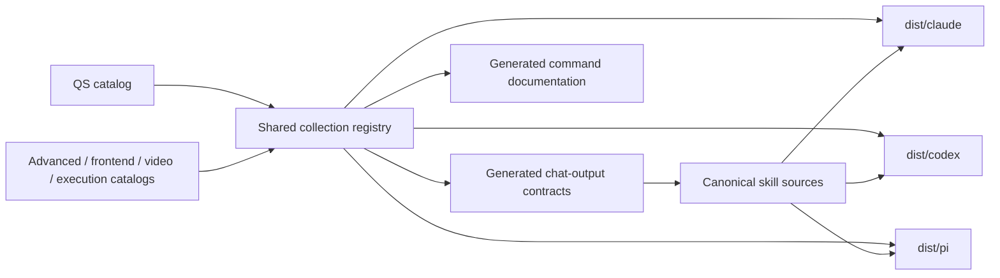

# QuickStark Skills architecture

## System at a glance

QuickStark exposes twelve core commands and optional specialist (9), advanced (12), frontend (4), video (1) and execution (1) commands. All public names use QS. Private capabilities preserve the required source workflows without adding dropdown commands. Claude, Codex and Pi projections share catalog membership; selected native transactions support Codex, Claude Code and Pi.

## Sources of truth

| Component | Authoritative source | Responsibility |
| --- | --- | --- |
| QS identity and behavior | `tooling/catalog/qs-skill-catalog.mjs` | Core and specialist membership, fixed v2 migration inventory, lifecycle order, invocation policy, effort/report modes, and ranked continuations. |
| PS identity and provenance | `tooling/catalog/ps-skill-catalog.mjs` | Thirteen commands, sixteen private capabilities, pinned pstack provenance, fixed dispositions, completion evidence, and continuations. |
| Shared collection identity | `tooling/catalog/skill-collection-registry.mjs` | Unique public command identity, package ownership, and exact Codex, Claude, and Pi literals. |
| Canonical QS sources | [Public skill index](../skills/README.md) | Public QS instructions and matching `agents/openai.yaml` metadata. |
| Historical PS sources | `docs/reference/skills/pstack/commands/`, `docs/reference/skills/pstack/internal/` | Public PS instructions and private host-neutral capabilities. |
| Shared output policy | `docs/skill-run-contract.md`, `tooling/generation/sync-skill-output-contracts.mjs` | Direct chat presentation, completion states, internal clear-writing pass, and exact next-prompt format. |
| Documentation generator | `tooling/generation/sync-v3-docs.mjs` | Concise command pages generated from registered metadata. |
| Package projector | `tooling/generation/sync-codex-plugin.mjs` | Deterministic Claude, Codex, and Pi packages, manifests, capabilities, notices, and shared catalog metadata. |
| Published-version installer | `install.sh`, `scripts/install-skills.mjs` | Resolve a stable published tag, pin its commit, validate packages locally and retain versioned source checkouts. |
| Ordinary client update | `tooling/install/update-skills.mjs`, `tooling/install/clean-install-skills.mjs` | Save package choices, back up originals, clean-reinstall known packages and verify each client independently. |
| Historical migration and recovery | `tooling/install/managed-skills.mjs` and migration modules | Read-only plan/verify, explicitly authorized resource migration and frozen-journal recovery; old journals do not drive ordinary installation. |
| Behavioral verification | `tests/` | Public surface, routing, safety, direct-chat contracts, clear writing, and projection integrity. |

Reference material under `docs/reference/skills/misc/`, `docs/reference/skills/personal/`, `docs/reference/skills/in-progress/`, and `docs/reference/skills/deprecated/` is never promoted or packaged.

The [decision and stewardship index](./adr/README.md) records earlier locations and their current owners. Shared private sources live under `skills/_shared/` by owner.

## Repository roots

| Tracked root | Contents |
| --- | --- |
| `skills/` | Canonical command instructions, metadata and shared private resources. |
| `tooling/` | Catalogs, generators, installer, release checks and verification tools. |
| `tests/` | Regression tests and their offline fixtures. |
| `docs/` | Developer guides, specs, reference material and verification history. |
| `dist/` | The six active packages per host. |
| `packages/`, `codex/`, `pi/` | The exact PS 3.8.0 payloads at `packages/ps-skills`, `codex/plugins/ps-skills` and `pi/packages/ps-skills`. Keep these paths while supported installations or frozen recovery records reference them. Retirement requires verified migration and separate authorization. |
| `scripts/` | Published installer files and public CLI entry points. See [published entry points](../tooling/README.md#published-entry-points) for the consumers of each file. |

The root `.agents/plugins/marketplace.json` and `.claude-plugin/` are native
host entry points. `.claude/CLAUDE.md` is repository guidance reached through
the root `AGENTS.md` symlink. `.github/` and `.changeset/` own the CI and
release workflows. Root build, version and license files apply to the whole
project.

## Package boundaries

Each public command belongs to exactly one package:

- `qs-skills`: twelve lifecycle-ordered core commands and five private QS capabilities, including delegation.
- `qs-specialists`: nine optional specialist commands.
- `qs-advanced`: twelve distinct PS-derived outcomes, sixteen private capabilities and the Lauren Tan notice.
- `qs-frontend`: four output-specific roots and private design/image references.
- `qs-video`: one root and 21 private modules/workflows.
- `qs-execution`: one root with the complete private Unlazy closure.

The unchanged `ps-skills` 3.8.0 transition payload remains available only for observing and withdrawing old registrations. It is excluded from fresh selection. Original identities and attribution remain in [provenance](./upstream/provenance.md).

Packages never import another package's skill bodies. Canonical, Claude and Pi explicit commands retain both invocation restrictions. Generated Codex copies omit both markers through the projector compatibility exception so explicit commands remain visible to current clients. Generated package trees are snapshots and are never edited independently.

Keep `package.json`, `package-lock.json`, all six active Claude manifests, all six active Codex manifests, and all six active Pi manifests on the same version; the retained PS transition stays at 3.8.0.

## Run lifecycle

1. Resolve exactly one public root command from explicit user intent or permitted model invocation.
2. Normalize `effort=quick|standard|deep` and `report=brief|full` independently.
3. Perform only the root's authorized work. Internal capabilities remain inside that run.
4. Determine one completion state: `complete`, `continuation-required`, `input-required`, or `failed`.
5. Select at most one catalog-approved continuation that owns verified unfinished work. Complete work with no follow-up emits no prompt; `/qs-deploy-release` is terminal.
6. Apply the internal clear-writing pass after facts, inferences, and uncertainties are separated.
7. Present the result directly in chat with status, outcome, decision-grade evidence, noteworthy failures, material outputs, specifications, Work summary and at most one eligible next-work prompt.

The result stays in the current conversation; the run creates no secondary result artifact or external URL.

## Clear-writing boundary

The clear-writing pass is shared policy, not a public command and not a cross-package skill-body import. Every generated completion contract contains the self-contained rule: lead with the outcome, use concrete nouns and verbs, preserve necessary qualifications and technical terms, and remove repetition.

The PS catalog retains `plain-writing` as one of its fixed sixteen internal capabilities because it is the disposition of upstream `skill:unslop`. QS commands receive the same final synthesis through the shared output contract without changing the fixed PS inventory.

## GitHub integration and release

The [installation guide](./install-and-update-skills.md) begins with client and
server restart commands. After package updates, refresh the active client's skill
catalog; source synchronization alone does not refresh a running App Server.

Implementation, appropriate tests, and independent review precede delivery. `/qs-git-merge` inspects the actual branch, remote tracking, pull request, checks, and mergeability before selecting an integration operation. `/qs-deploy-release` remains a separate explicitly approved release or deployment operation.

A local commit is not a published commit. A version in a manifest is not evidence of a tag, release, merged pull request, or deployed service. Verify each external artifact independently, never push personalized changes to the read-only `upstream` remote, and preserve Matt Pocock's and Lauren Tan's MIT notices.

See [contributing](./contributing.md) for the catalog-first change workflow and [the shared run contract](./skill-run-contract.md) for presentation details.
